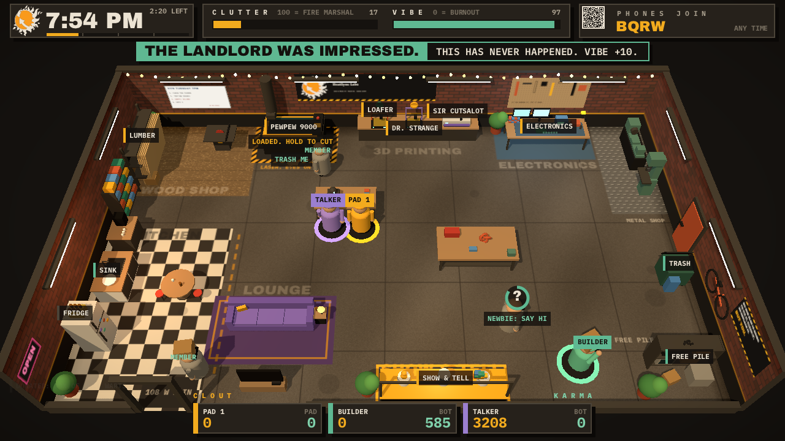

# DO-OCRACY

Whoever does it, decides. Nobody does the dishes.

DO-OCRACY is an arcade game about one Tuesday night of Hack Your Hackerspace at [HeatSync Labs](https://heatsynclabs.org). It ships as a single [wasmcart](https://github.com/wasmcart/wasmcart) cartridge, `do-ocracy.wasc`, built to live on the shared game station: Batocera, RetroArch, the wasmcart libretro core. Up to 8 members play at once on gamepads, keyboards and phones. Phones join by scanning a QR code on the screen, with no app and no account.



## The game

It is 7 PM on a Tuesday. The doors are open, the laser is calling, and the sink already has three dishes in it.

Everybody scores two things:

- CLOUT is for you. Cut something on the large 80W laser, run a print on Ouch or Dr. Strange, solder something at the bench, cut a sticker on Sir Cutsalot (always free). Carry it to the show window.
- KARMA is for the space. Wash the dishes. Haul scrap, empty Club-Mate bottles and print spaghetti to the trash. Move donations (a very heavy CRT, three broken printers, a chest freezer that runs fine) to the Free Pile. Unclog the printers. Clean the laser when it is covered in dust. Unplug the daisy-chained power strips. Say hi to the newbies.

The space has two meters:

- CLUTTER goes up with every mess on the floor, every dirty dish, every broken machine. At 100 the fire marshal is on the way. Five seconds later the night is over.
- VIBE drains when clutter is high, when a newbie walks out because nobody said hi, and when the landlord sees the Free Pile. At 0 everybody burns out.

Survive until 11 PM and the space lives to see another Tuesday. Then the scoreboard ranks everyone by clout and hands out awards. Most clout with the least karma gets GLAMOUR BIAS. Most karma gets JANITORIAL CO-OP, and a banner that says they were the real winner. Whoever did nothing gets LURKER: "Paid dues. Said nothing. Kept the lights on."

If the space closes, every point of clout is void. Karma stands. It is the commons dilemma with a laser cutter. Glamour work is fun and pays you. Janitorial work is boring and pays the room. The laser leaves scrap. The prints jam. Club-Mate makes you fast and then you litter. Every newbie you greet becomes a member who quietly cleans up after everyone, for a while, until they drift away (the four year sine wave).

The night throws events at you: IT IS 118 OUTSIDE, HABOOB, SOMEBODY BROUGHT TACOS, LANDLORD WALKTHROUGH, ANY PARTICULAR REASON DR. STRANGE IS DOWN?, and the occasional LINUX NIGHT: CANCELED, which does nothing. X makes a proposal ("I think we should... form a committee"). It earns zero clout and says so.

When nobody is playing, the cabinet runs an attract mode. Three archetypes play a night on their own: BUILDER (mostly karma), TALKER (proposals and the laser) and FOUNDER (all glamour). If you play alone, BUILDER and TALKER clock in with you, so there is a commons to ruin.

## The space

The floor plan is a working makerspace, zone by zone: the wood shop and lumber rack at the back left (OSB floor, sawdust, a table saw), the laser on its hazard-taped mat, the printing counter with Ouch, Dr. Strange and Sir Cutsalot, the electronics bench on its ESD mat, the metal shop on the right wall (a lathe, a mill that is not a Bridgeport) by the alley door and the dumpster, a checkerboard kitchen with the coffee station and a table, the lounge with the lurker couch, the work island and the assembly table in the middle, Show & Tell in the front window, and the Free Pile by the door. Brick walls, strip lights, string lights, a bike on the wall, the whiteboard that says GOTO 1.

Station labels are level data (src/levels.c) and use the lab's public tool names: LARGE 80W LASER, OUCH, DR. STRANGE, SIR CUTSALOT. The old joke names are retired everywhere.

The floor and walls are textures painted at startup with the HUD's own drawing routines, so there are no image files in the cart.

## Controls

| | Move | Do it (hold for work) | Drop | Propose | Begin |
| --- | --- | --- | --- | --- | --- |
| Gamepad (any of 4) | stick or d-pad | A (south) | B (east) | X or Y | Start |
| Keyboard player 1 | WASD | Space (or E) | Q | R | Enter |
| Keyboard player 2 | arrows | . (period) | , (comma) | / (slash) | Enter |
| Phone | drag the stick box | A | B | X | Start the night |
| Keyboard under RetroArch | arrows | Z | X | A | Enter |
| Keyboard in the desktop wasmcart player | arrows or WASD | X or Space | Z | | Enter |

Press A on the title to take the menu, then PLAY. Anyone else who presses A waits at the door and is seated in the lobby. In the lobby, press Start (Enter, or right Shift on the arrows half) to say READY; when every player is ready a 3 second countdown starts the night, and otherwise it starts by itself 25 seconds after the last join. Hold B for 1.5 seconds to go home (alone, 1 second takes you back to the menu). Drop in any time during the night.

The two keyboard players read raw keys, which the browser player delivers. Under RetroArch (Batocera) and in the desktop `npx wasmcart` player, the keyboard arrives as pad 1 with that host's own bindings instead, shown in the last two rows. Someone who clocks in on a pad or the keyboard and then does nothing for 75 seconds goes home, so the cabinet can fall back to its demo.

## Never guess what to do

- Whatever you are carrying gets arrows on the floor, a highlight in your colour on the place it goes, and a short label over your head ("TO SHOW & TELL", "TO THE TRASH").
- Under your feet is a prompt with your own button on it: A for a pad, SPACE or . for the keyboard.
- Every station has an amber edge if it makes clout or a teal edge if it is karma work, and a red ! when something is wrong there.
- Messes on the floor get a ring. On a group's first night it says SWEEP ME or MOP ME; after that a broom sits on the ring. A daisy chain always says UNPLUG ME. Anything left too long gets one RED TAG label instead of its name. A newbie shows a ? with a patience ring and says SAY HI only when it is about to leave.
- Before the first night a rules flash plays five picture cards (A for the next card, B to skip); HOW TO PLAY on the menu plays it any time. Then a coach line runs over the first forty seconds, with grey arrows toward the station it names. The HELP setting turns both off or on every night.
- Holding a button fills the prompt under your feet, so you can see your progress wherever you stand. Player markers draw on top of everything.
- The clock counts down the time left in the night in big digits, the wall clock small beside it, over a progress bar marked in hours. CLUTTER carries the fire marshal's helmet and VIBE a heart; the phone join strip shrinks to its QR and code after 45 seconds (CO-OP and VERSUS put TEAM KARMA or the LEADER there instead). Station names stay dim until you are near one or it needs you. Messages get their own strip under the top row, above the room, so they never cover the floor.
- Labels in the room never stack: each one moves to the nearest free spot.
- Every event banner says what it means ("HABOOB! Dust on the floor and in the laser. Sweep it.").
- The title shows the room behind a light scrim with nine strings at most; after 20 idle seconds the attract screen runs the floor loop tips. The lobby shows one seat card per player along the bottom, with the bots a solo night will add.

## Phones

The cart talks to phones itself. It dials `wss://relay.clasp.to` through wasmcart's `wc_peer_open` and speaks [CLASP](https://clasp.to)'s binary protocol directly: HELLO, SUBSCRIBE and event PUBLISHes carrying short strings. Nothing wraps the cart, so this works in RetroArch on Batocera the same as in a browser. The manifest grants the cart exactly one network destination, `relay.clasp.to`.

The QR code opens `web/join.html#ROOM`, the phone controller. The room code is four letters, drawn from the relay's session id on first contact, so two cabinets never share one. The wire format is documented at the top of [src/net.h](src/net.h). If the relay cannot be reached, the screen says PHONES OFFLINE and the game carries on with controllers.

The QR points at the URL in [config.json](config.json), `https://virgilvox.github.io/do-ocracy/join.html` by default. The GitHub Pages workflow in `.github/workflows/pages.yml` publishes `web/` there. To use a phone page on the shop's own network instead:

```sh
JOIN_URL=http://192.168.1.20:8747/join.html ./build.sh
npm run serve        # serves web/ on port 8747 and prints the LAN address
```

## Put it on the game station (Batocera)

1. Install the wasmcart libretro core once. Follow [wasmcart-libretro/frontend/batocera](https://github.com/wasmcart/wasmcart-libretro/tree/main/frontend/batocera): copy `wasmcart_libretro.so`, the `.info`, `es_systems_wasmcart.cfg`, `wasmcart.service.sh` and `install.sh` to the box and run `sh install.sh`.
2. Copy `build/do-ocracy.wasc` (or `web/do-ocracy.wasc`, the same file) to `/userdata/roms/wasmcart/`.
3. Restart EmulationStation. DO-OCRACY shows up under wasmcart.

The core gives GL carts a GLES3 context and dials the relay with Node's own WebSocket inside the core, so phones work as long as the box is online. RetroArch maps the keyboard onto RetroPad 1. The raw-keyboard seats only exist in the browser and Node hosts.

## Play it in a browser

```sh
npm run serve
# open http://localhost:8747/ and press Clock in
```

`web/index.html` runs the same `.wasc` with wasmcart's web host (`CartHostWeb`, vendored in `web/vendor/`), plays the cart's audio through WebAudio, and reads gamepads and the keyboard.

## Build

You need [Emscripten](https://emscripten.org) (`emcc`/`em++`, the build looks in `~/emsdk`), Node 22 or newer, and the submodules:

```sh
git submodule update --init
npm install
./build.sh                 # build/do-ocracy.wasc and web/do-ocracy.wasc
```

The cart is about 1.1 MB: three.c, the game, the Bellows engine, four fonts and a config file. The floor and wall textures are painted at startup, so there are no images in it.

Check it the way romdev does (`npx romdevtools`, then from any MCP client or plain HTTP):

```sh
curl -s -X POST localhost:7331/tool/loadMedia -H 'content-type: application/json' -H 'x-romdev-session: hsx' \
  -d "{\"platform\":\"wasmcart\",\"path\":\"$PWD/build/do-ocracy.wasc\"}"
curl -s -X POST localhost:7331/tool/wasm -H 'content-type: application/json' -H 'x-romdev-session: hsx' -d '{"op":"conformance"}'
```

Headless testing, on the same GL path as the native hosts:

```sh
node tools/shot.mjs build/do-ocracy.wasc build/shots/s 60,600            # screenshots of frames 60 and 600
node tools/shot.mjs build/do-ocracy.wasc build/shots/s 600 script.json   # with scripted pad input
WAV=build/night.wav node tools/shot.mjs ...                               # and the audio
PACE=1 node tools/shot.mjs ... & node tools/phone-sim.mjs ROOM "NAME"     # a fake phone over the real relay
```

## The music

A love letter to the Hackers (1995) soundtrack, synthesized live in the cart: Orbital's dreamy arpeggios, Underworld's hypnotic sixteenths, the Prodigy's breakbeats and rave stabs, and a squelching acid line under all of it. Previews: [lobby](docs/music-lobby.m4a), [night](docs/music-night.m4a), [closing time](docs/music-closing.m4a).

- Halcyon Tuesday (lobby and attract): ambient electronica, 120 bpm. A slow rising arpeggio through long echoes, glassy bell melody, a soft kick and sub coming in on the second half.
- Hack the Planet (the night): acid breakbeat, 136 bpm, E minor with a Phrygian F. The intro is offbeat hats and an acid line whose filter opens over eight bars; the build adds a four-on-the-floor kick, claps and a three-against-four hypnotic arpeggio, with a snare roll into the drop. The drop is a breakbeat with ghost notes, rave stabs and the riff. Then a pads-only breakdown with a dreamy melody and a B major turnaround, and the second drop adds a counter line under the riff.
- Mess the Planet (the last 30 seconds): a 160 bpm breakbeat rush with everything on.

The songs are data at the top of `src/audio_bellows.cpp` in doot-doot-revolution's note format (`E5:2 G5:2 | ...`, lengths in sixteenths), with the acid line and breakbeat as 16-step arrays, so writing a new one is editing strings.

## How it is made

| Part | What it is |
| --- | --- |
| [src/main.c](src/main.c) | The wasmcart entry points, input from pads, keyboard and phones, phase flow, camera |
| [src/game.c](src/game.c) | The night: stations, messes, newbies, events, meters, scoring, the archetype bots |
| [src/world.c](src/world.c) | The 3D space in [three.c](https://github.com/monteslu/three.c): the three.js API in C, drawing three.js r186's own programs |
| [src/draw.c](src/draw.c), [src/hud.c](src/hud.c) | The 2D layer in HeatSync's GANTRY theme: stb_truetype text, panels, caution tape, the QR, and the HeatSync mark rasterized from its official paths |
| [src/audio_bellows.cpp](src/audio_bellows.cpp) | Music and effects on [Bellows](https://bellows.live) (bellows-embedded, the C++ port of its DSP core), written the way doot-doot-revolution writes songs: sections, a chord per bar, written hooks, layers in and out, fills, voice-led pads, reverb and delay sends, a compressor and limiter |
| [src/net.c](src/net.c) | The CLASP client, under 200 lines of C |
| [src/content.h](src/content.h) | Every word in the game. Edit freely |
| [tools/states.txt](tools/states.txt) | The r186 material states the game draws; `build.sh` turns them into a program table with three.c's `gen-project-table.mjs` |
| [web/](web/) | The browser player and the phone controller |

The HUD is a 1280x720 texture redrawn on the CPU each frame and composited over the scene by a second three.c render. The renderer runs with `set_exact_output` so both passes share r186's output target.

## Credits and licences

The game code is MIT (see [LICENSE](LICENSE)).

- [three.c](https://github.com/monteslu/three.c) (MIT) and [three.js](https://threejs.org) r186 (MIT), whose generated programs three.c draws with
- [wasmcart](https://github.com/wasmcart/wasmcart) (MIT), the spec, the C headers and the web host in `web/vendor/wasmcart`
- [Bellows](https://github.com/virgilvox/bellowsjs) bellows-embedded (Apache-2.0, `third_party/bellows/LICENSE`)
- [QR Code generator](https://github.com/nayuki/QR-Code-generator) by Project Nayuki (MIT), [stb_truetype](https://github.com/nothings/stb) (public domain), [fflate](https://github.com/101arrowz/fflate) (MIT)
- Archivo Black, IBM Plex Mono and Charis SIL, under the SIL Open Font License (`assets/fonts/OFL.txt`)
- The HeatSync Labs mark and the GANTRY theme belong to HeatSync Labs. The mark is drawn from its official paths, in its two colours, unmodified
- Hackerspace patterns and vocabulary (do-ocracy, glamour work, the sine wave of enthusiasm, the Tuesday pattern) come from Ohlig and Weiler's Hackerspace Design Patterns (24C3, 2007) and the people who have kept HeatSync open since 2009

Be excellent to each other.
